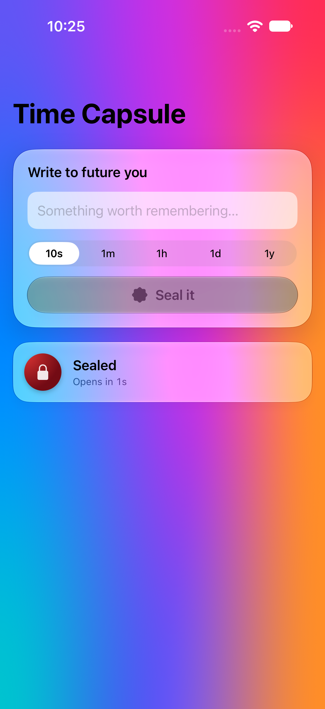
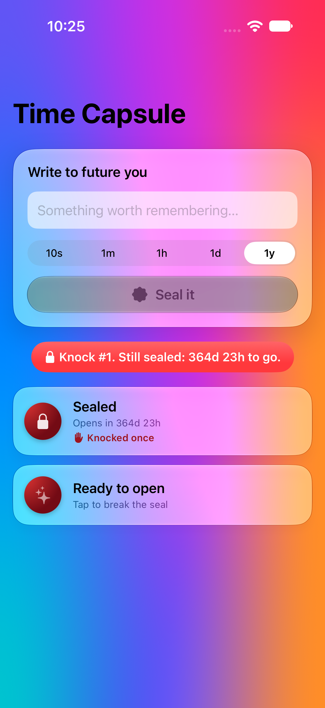
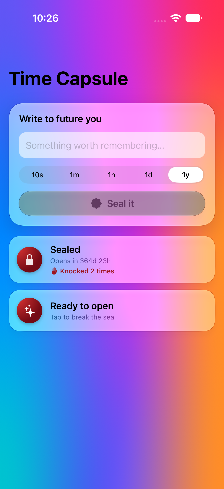
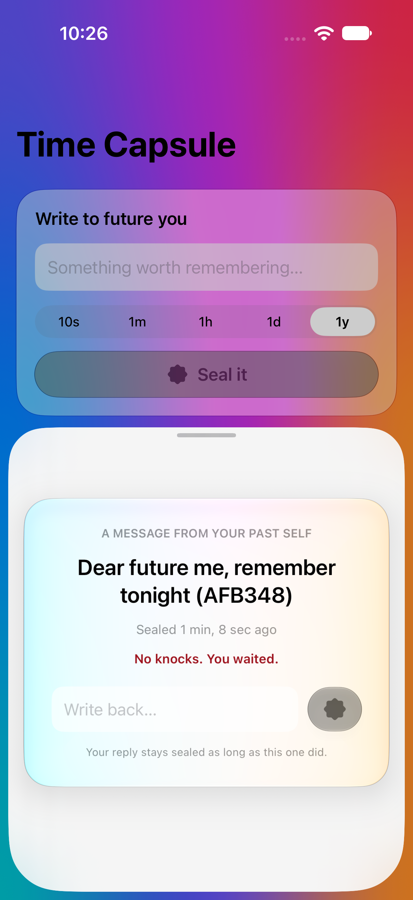
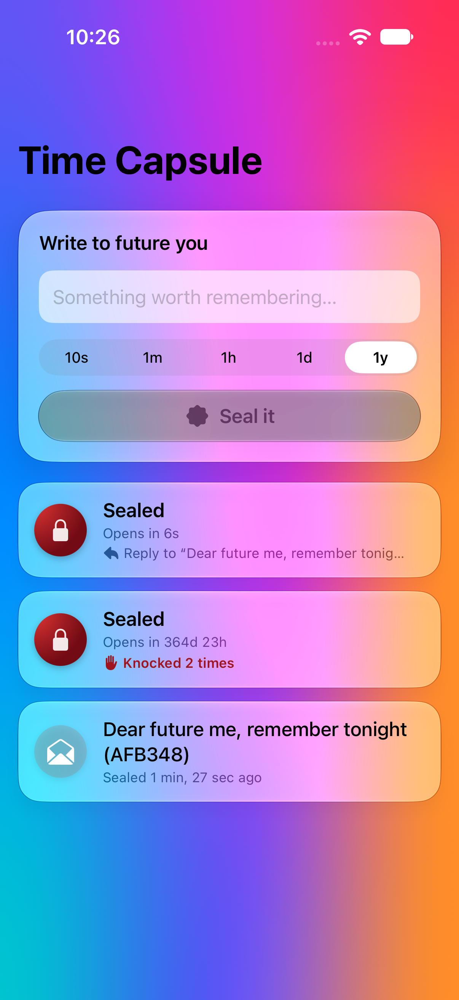
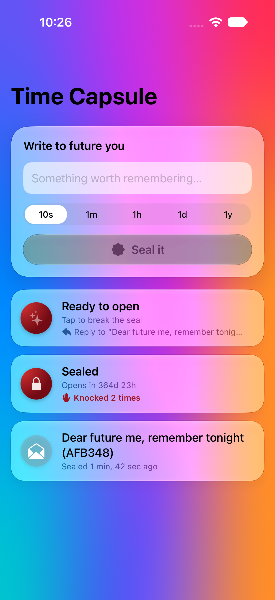

# Latest e2e run

**E2E passed** · commit `f3f8c06` · [workflow run](https://github.com/dcantu96/test-ios-app/actions/runs/43110311983)

| | |
|---|---|
| Xcode | Xcode 27.2 |
| Simulator | iPhone 18 Pro, iOS 27.2 (24B8117) |
| Database | PostgreSQL 17.11 |
| API tests | pass 7, fail 0 |

Branch `write-back` · [API request log](api.log) · [xcodebuild log](xcodebuild-test.log)

## Steps

### 1 launched

### 2 sealed for 10 seconds

### 3 server refused to open the year long capsule

### 4 second knock counted

### 5 ready to open

### 6 seal cracked message revealed

### 7 wrote back sealed for as long as the first one waited

### 8 after relaunch loaded from postgres

