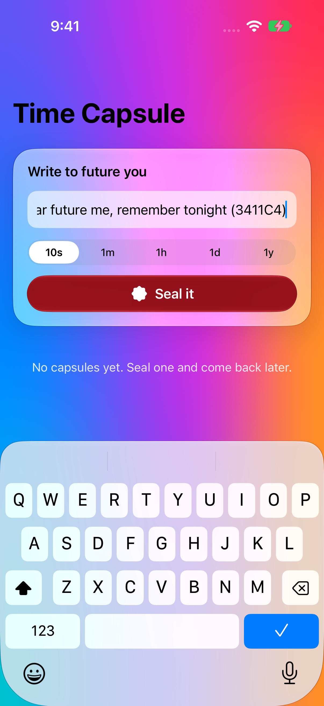
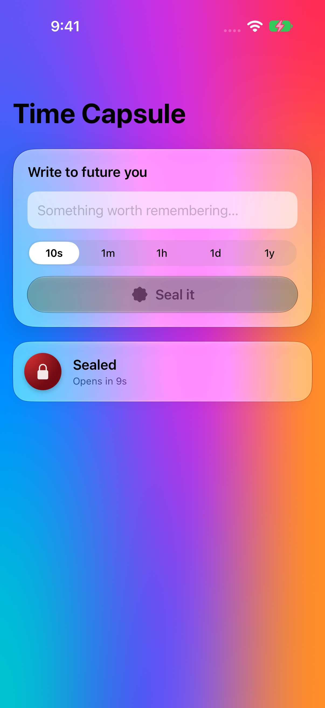
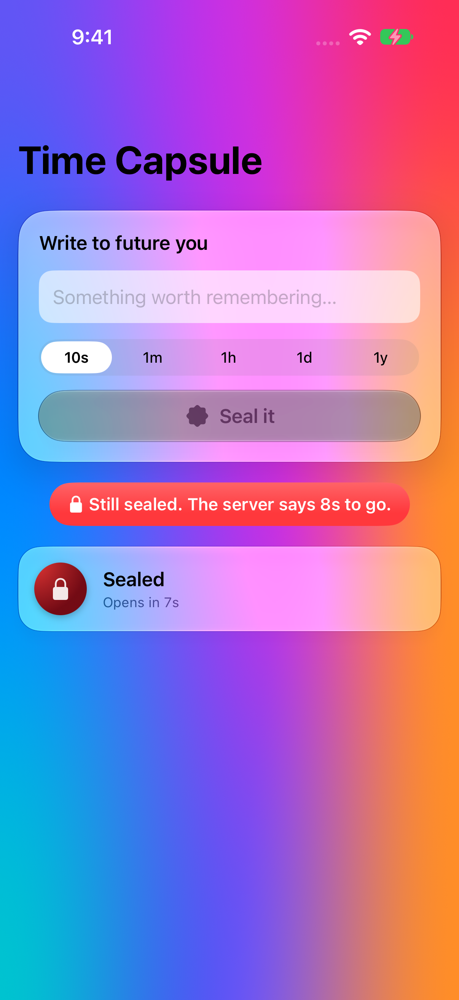
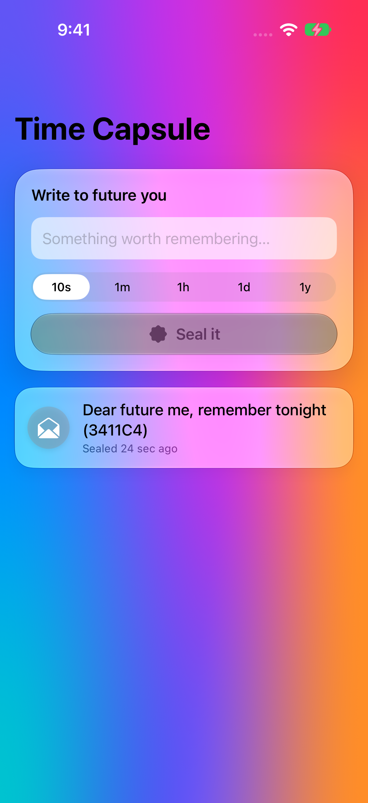

# Latest e2e run

**E2E passed** · commit `7b10d58` · [workflow run](https://github.com/dcantu96/test-ios-app/actions/runs/42955780086)

| | |
|---|---|
| Xcode | Xcode 27.2 |
| Simulator | iPhone 18 Pro, iOS 27.2 (24B8117) |
| Database | PostgreSQL 17.11 |
| API tests | pass 3, fail 0 |

[Screen recording of the whole test (e2e.mp4)](e2e.mp4) · [API request log](api.log) · [xcodebuild log](xcodebuild-test.log)

## Steps

### 1 launched

### 2 message written

### 3 sealed with countdown

### 4 server refused early open

### 5 ready to open

### 6 seal cracked message revealed

### 7 after relaunch loaded from postgres

